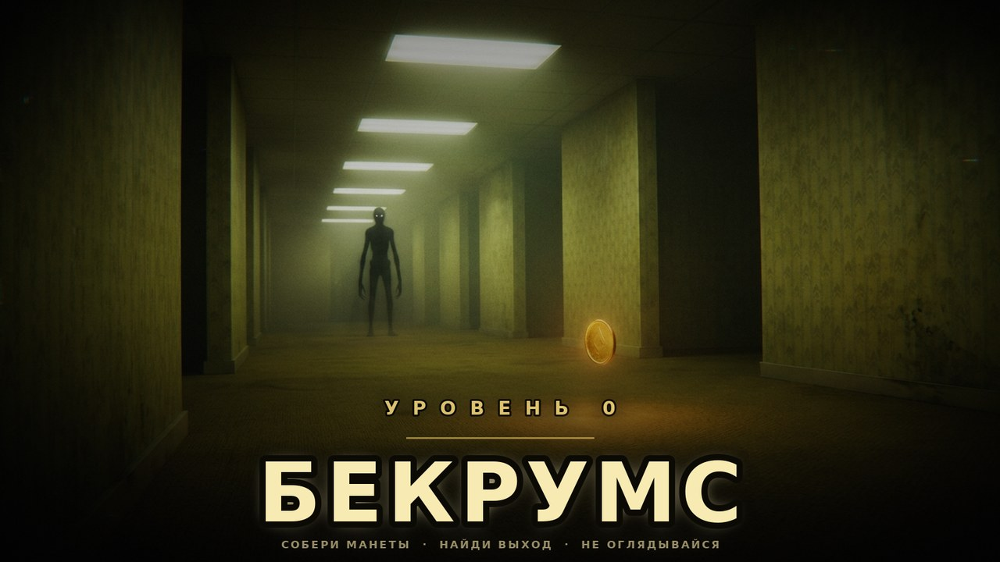

# БЕКРУМС: УРОВЕНЬ 0

**3D-хоррор от первого лица на Godot 4.** Бесконечные жёлтые комнаты, мокрый ковролин,
гудение ламп, манеты, которые нужно собрать, и **ОНО** — то, что живёт между стенами.



---

## Что это

Ты провалился на Уровень 0. Здесь нет карты, нет выхода из лабиринта и нет никого,
кто бы ответил на крик. Есть только жёлтые обои, гудящие лампы — и манеты.
Собери их все, найди дверь с красной табличкой «ВЫХОД» и не дай себя догнать.

Игра целиком процедурная: лабиринт, материалы, освещение, звук и интерфейс
генерируются кодом. В проекте **нет ни одного внешнего ассета** — ни текстур,
ни моделей, ни аудиофайлов.

---

## Запуск

1. Скачай **Godot 4.4 или новее** (стандартная версия, не .NET): <https://godotengine.org/download>
2. `Godot → Import → выбери папку репозитория (файл project.godot) → Import & Edit`
3. Нажми **F5** (Run Project).

Рендерер — **Forward+** (в нём работают объёмный туман, SSAO и свечение).
Если игра тормозит — в меню выбери сложность/настройки и включи
`КАЧЕСТВО: НИЗКОЕ` (отключает объёмный туман и SSAO, уменьшает число активных ламп).

Экспорт в exe: `Project → Export → Add… → Windows Desktop / Linux`,
затем `Export Project`. Шаблоны экспорта Godot скачает сам.

---

## Управление

| Клавиша | Действие |
|---|---|
| `W A S D` | идти |
| `Shift` | бежать (тратит выносливость, слышно далеко) |
| `Ctrl` / `C` | присесть (медленно, но почти бесшумно) |
| `F` | фонарик вкл/выкл (тратит батарею) |
| `E` | взаимодействие: записки, дверь |
| `Esc` | пауза |
| мышь | обзор |

---

## Механики

**Манеты.** Их нужно собрать все (6 / 8 / 10 в зависимости от сложности).
Манета парит, вращается, светится и подбирается, если подойти. Каждая манета
**звенит** — звон слышит ОНО и идёт проверять, кто это. После последней манеты
включается красная подсветка выхода и в HUD появляется **компас** со стрелкой
на дверь — до этого искать её бессмысленно.

**Выход.** Металлическая дверь с красной табличкой «ВЫХОД» стоит в самом дальнем
углу лабиринта. Пока манеты не собраны — заперта. Собрал все → `E` у двери → побег.

**Фонарик и батарейки.** Заряд тратится, ниже 25% фонарь начинает мигать,
на нуле — гаснет. Зелёные батарейки разбросаны по уровню и дают +35%.
Фонарик — единственный надёжный свет, но его луч видно издалека.

**Выносливость.** Бег даёт 5.3 м/с против 3.4 м/с у твари, но запас сил
кончается за ~5 секунд и восстанавливается с задержкой. Бежать придётся
рывками, а не постоянно.

**Страх.** Растёт, когда ОНО рядом или когда ты в темноте. Влияет на виньетку,
дрожание картинки, сердцебиение, шёпот и дыхание камеры. Это не шкала смерти —
это атмосфера.

**Записки.** Четыре записки приклеены к стенам. Читаются через `E`,
рассказывают, что случилось с предыдущими гостями. За чтение дают +1 к статистике.

**ОНО.** Тварь патрулирует лабиринт по A*-навигации между клетками.
Она:
- видит тебя в радиусе ~30 м, если между вами нет стены;
- слышит бег на ~19 м и звук шагов;
- замечает фонарик;
- теряет след через несколько секунд, если ты ушёл из поля зрения;
- ускоряется, чем больше манет у тебя в кармане;
- топает всё громче, когда подходит — слушай.

Первые ~20 секунд после старта она спит и просыпается с неприятным звуком.

**Смерть.** Если ОНО дотянется — джампскейр, крик и экран «ТЕБЯ НАШЛИ».
Лучшее время забега и статистика сохраняются.

---

## Сложность

| | СПОКОЙНО | НОРМАЛЬНО | КОШМАР |
|---|---|---|---|
| Манет | 6 | 8 | 10 |
| Скорость твари | ×0.88 | ×1.0 | ×1.14 |
| Расход батареи | 0.6 %/с | 0.85 %/с | 1.2 %/с |

Сложность переключается кнопкой на титульном экране и сохраняется между запусками.

---

## Технические детали

- **Процедурный лабиринт** (`scripts/maze.gd`): recursive backtracker 27×27 клеток
  (клетка 4.4 м, мир ~119×119 м), затем пробиваются петли и большие залы —
  идеальный лабиринт для бекрумса слишком тесный. Несвязанные карманы засыпаются,
  чтобы всё было достижимо. Проверено на 40 сидах: 406–440 проходимых клеток,
  до выхода в среднем ~50 клеток пути.
- **Геометрия** строится одним `ArrayMesh` с тремя поверхностями (пол / стены / потолок)
  через `SurfaceTool`; коллизии — слияние строк сплошных клеток в `BoxShape3D`.
- **Материалы** — четыре процедурных шейдера: обои с полосами и потёками,
  влажный ковролин с ворсом, плиты потолка, «пустотная» тварь и золото манет.
- **Свет**: лампы с мерцанием (`fluorescent.gd`), у каждой — шейдовый спрайт-панель;
  включены только 7–12 ближайших ламп (`maze._process`) с dual-paraboloid тенями,
  чтобы не утонуть в шейдоу-мапах.
- **Пост-эффекты** (`shaders/post_fx.gdshader`): VHS-зерно, хроматическая аберрация,
  бочка, виньетка, пульс страха, цифровые помехи для джампскейра.
- **Звук полностью синтезируется** (`scripts/audio_bank.gd`): гудение лампы, гул комнаты,
  сердцебиение, шаги, манета, шёпот, рычание, крик, скример. `AudioStreamWAV`
  собирается из сэмплов на старте, есть реверб-шина «Maze».
- **ИИ твари** (`scripts/entity.gd`): состояния `WANDER / HUNT / SEARCH`, проверка
  видимости по сетке (DDA-сэмплирование клеток), слух на бег, память о последней
  позиции, прямой догон в упор. Навигация — `AStar2D` по проходимым клеткам.
- **Интерфейс** (`scripts/ui.gd`) целиком строится кодом: HUD, компас на `draw_*`,
  титульный экран, пауза, настройки, смерть, побег, записки, переходы.
- Сейвы в `user://settings.cfg` и `user://progress.cfg` (Godot сам кладёт их
  в `%APPDATA%\Godot\app_userdata\БЕКРУМС...`).

---

## Структура проекта

```
project.godot           настройки, автозагрузки Game и AudioBank
scenes/
  main.tscn             единственная полноценная сцена (корень + main.gd)
  player.tscn           CharacterBody3D, камера, фонарик, луч взаимодействия
  coin.tscn             манета: меш, шейдер, свет
  battery.tscn          батарейка
  note.tscn             записка на стене (StaticBody3D, слой interactable)
  exit_door.tscn        дверь «ВЫХОД» с красной табличкой и светом
  entity.tscn           тварь: тело, голова, глаза, свет
scripts/
  main.gd               сборка уровня, состояния игры, атмосферные события
  game.gd               (autoload) настройки, прогресс, сигналы
  audio_bank.gd         (autoload) синтез и воспроизведение звука
  maze.gd               генератор лабиринта, геометрия, свет, A*
  player.gd             контроллер игрока, страх, фонарик, звуки шагов
  entity.gd             ИИ твари
  coin.gd / battery_pickup.gd / note.gd / exit_door.gd
  fluorescent.gd        мерцание ламп
  ui.gd                 весь интерфейс и пост-эффект
shaders/
  wallpaper.gdshader  carpet.gdshader  ceiling.gdshader
  entity.gdshader     coin.gdshader     post_fx.gdshader
```

---

## Где что крутить

| Что | Где |
|---|---|
| Размер мира | `maze.gd`: `COLS`, `ROWS`, `CELL` |
| Число манет | `game.gd`: `COIN_GOALS` |
| Скорости | `player.gd`: `WALK_SPEED`, `SPRINT_SPEED`; `entity.gd`: `base_speed` |
| Число активных ламп | `maze.gd`, `_process`: `limit` |
| Туман и свечение | `main.gd`: `_setup_environment` |
| Кривая страха | `player.gd`: `_update_fear` |
| Дальность и цвет фонарика | `scenes/player.tscn`, узел `Flashlight` |

---

## Если что-то не так

- **Темно и ничего не видно** — так и задумано; включи фонарик (`F`), он горит
  с первой секунды. Проверь, что рендерер Forward+ (Project Settings → Rendering).
- **Низкий FPS** — настройки → `КАЧЕСТВО: НИЗКОЕ`, либо уменьши `COLS/ROWS` в `maze.gd`.
- **Нет звука** — проверь ползунок «ГРОМКОСТЬ» в настройках; звук генерируется
  при запуске и первые доли секунды может быть тишина.
- **Не запускается кнопка «Играть»** — окно должно быть активно; мышь захватывается
  автоматически, `Esc` возвращает курсор.

---

## Ассеты и лицензия

Весь код, геометрия, текстуры, звук и интерфейс созданы процедурно в этом репозитории.
Внешних ассетов нет. Шрифт — встроенный в Godot (Open Sans SemiBold), он содержит
кириллицу. Обложка в `screenshots/` сгенерирована для репозитория и в игре не используется.

Код можно свободно брать, ломать и переделывать.
